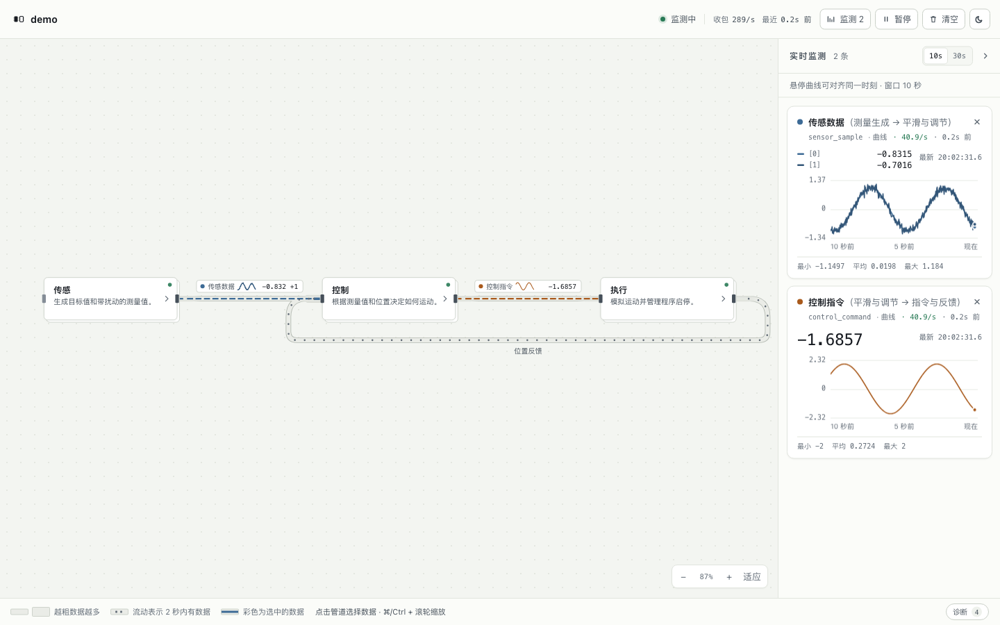
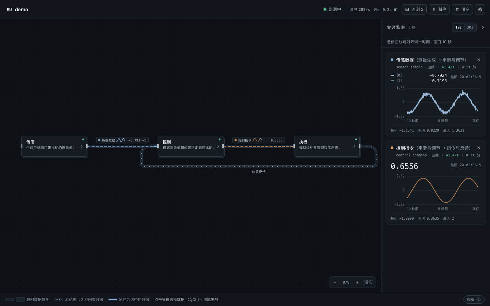

# 可视化编程模块 · 实时监测

用一份手写的 `module.md` 描述程序的模块划分与数据流，再用本地网页把它画成可交互的模块图，并对运行中的数值做实时监测。

项目没有第三方运行时依赖，只需要 Python 3.10+ 和现代浏览器。





## 特性

- **模块图**：解析 `module.md` 的模块层级与数据流，自动布局；支持进入子模块、面包屑、浏览器前进/后退。
- **实时数据**：`probe` 把数值通过 UDP 发到本机，页面在管道和侧栏卡片中显示曲线、数值、速率、延迟与统计。
- **监测视图**：顶部显示收包速率、最近数据时间；节点用状态点表示是否有实时数据；暂停后所有读数与曲线冻结，后台继续接收。
- **数据选择**：点击管道旁的数据名或管道本身选择观测项；支持多选、筛选、全选/清空。
- **时间窗口**：10 秒 / 30 秒切换；选择会保存在浏览器本地。
- **缩放**：自动适配宽度；右下角 `− / % / + / 适应`，也支持 `⌘/Ctrl + 滚轮`。
- **主题**：浅色/深色切换，默认跟随系统；选择保存在本地，首屏无闪烁。
- **诊断**：运行状态、时钟校正、无效包、未绘制的非实时流、`module.md` 解析问题集中查看。
- **热更新**：`module.md` 约 3 秒自动检查一次；修改后保留当前层级与已选数据。
- **零依赖**：运行时只用 Python 标准库和原生 HTML/CSS/ES Modules。

## 目录

```
probe/                 打点库：把运行中的数值通过 UDP 发出
viewer/
  server.py            本地服务：UDP 接收 + HTTP + 监测页面
  index.html           页面骨架
  app.css              监测看板样式（浅色/深色）
  app.js               页面交互、图表、轮询与布局
  model.mjs            纯逻辑：module.md 解析、布局排序、颜色、格式化
  theme-init.js        首屏主题初始化
examples/demo/         示例工程：传感器 → 控制器 → 电机 的闭环仿真
tests/                 Python / Node 测试
```

## 快速开始

```bash
# 1. 启动查看器（需要包含 module.md 的项目目录）
python3 viewer/server.py --project examples/demo

# 2. 另开终端运行示例工程（需要 uv）
cd examples/demo && ./run.sh

# 3. 浏览器打开
open http://127.0.0.1:8765/
```

也可以安装后使用命令行入口：

```bash
pip install -e .
p025-viewer --project examples/demo --open
```

示例工程会生成控制器逐周期的 CSV 日志到 `examples/demo/logs/`。

## 页面操作

| 操作 | 说明 |
| --- | --- |
| 点击模块 | 有子模块时进入；叶子模块打开说明 |
| 点击管道 / 数据名 | 选择观测项；一条管道有多条数据时打开选择菜单 |
| 悬停曲线 | 所有卡片对齐到同一时刻，显示该时刻的值 |
| 暂停 / 继续 | 顶部按钮或 `P`；冻结读数与曲线，后台继续接收 |
| 缩放 | 右下角按钮、`⌘/Ctrl + 滚轮`；`F` 适应窗口 |
| 时间窗口 | 侧栏头部 `10s / 30s` |
| 诊断 | 底栏“诊断”；显示运行状态、解析提示与未绘制流 |
| 清空观测 | 顶部“清空” |

页面地址会记录当前层级（如 `#/control/regulation`），刷新和浏览器后退都能恢复。已选数据按项目名保存在浏览器本地。

## module.md 格式

````markdown
# 项目名

## 模块

### sensing · 传感
概要：一句话说明。
详细：展开说明。

### sensing/signal · 目标生成
概要：...
详细：...

## 数据流
- sensing/signal -> sensing/measurement : target_value | 目标值 | 曲线 | 实时 | 详细说明
````

- 模块 id 用 `/` 表示层级，`### id · 名称` 是模块声明；`概要：` 和 `详细：` 是单行文本。
- 数据流格式：`源 -> 目标 : 名称 | 标签 | 显示方式 | 类型 | 说明`。
- `显示方式` 常用 `曲线`、`数值`、`文本`（`波形` 等同曲线）。
- **只有 `类型 = 实时` 的流会进入监测图**。配置、文件类流会出现在“诊断”里，相关模块用虚线边框标出。
- 数据流的源/目标必须是已声明的模块；未声明端点、自环、格式错误会进入诊断，不会悄悄消失。
- 代码块（``` / ~~~）内的示例不会被解析。
- 修改 `module.md` 后页面约 3 秒内自动刷新，无需重启服务。
- 已收到打点、但没有在 `module.md` 中声明数据流的数据名会列在“诊断”里；补上对应数据流后即可在图中选择。

## 打点

```python
from probe import probe

probe("control_command", 1.234)
probe("sensor_sample", [target, measured])
```

在 `examples/demo` 中由 `common.py` 统一把仓库根目录加入 `sys.path`，所以三个进程都可以直接 `from probe import probe`。外部使用时可把仓库根目录加入 `PYTHONPATH`，或 `pip install -e .` 后直接导入。

- `probe(name, value, timestamp=None)`：非阻塞发送；默认为当前 Unix 时间。
- `value` 可以是 JSON 标量、列表、字典；`NaN`/`Infinity` 会转成 `null`（曲线出现断点），`Decimal`、numpy 标量/数组、`bytes` 会做安全转换。
- 发送失败、序列化失败默认静默；设置 `PROBE_DEBUG=1` 打印第一次失败原因。
- 目标地址可用 `PROBE_HOST` / `PROBE_PORT` 覆盖，默认 `127.0.0.1:8766`；主机名只在导入时解析一次。
- `probe.stats()` 返回本进程的发送计数，便于调试。

## HTTP 接口

| 路径 | 说明 |
| --- | --- |
| `/` | 监测页面 |
| `/app.css`、`/app.js`、`/model.mjs`、`/theme-init.js` | 前端资源 |
| `/module.md` | 当前项目的模块说明 |
| `/names` | 各数据名最近一次收到打点的时间戳 |
| `/data?names=a&names=b&since=ts` | 指定数据在 `since` 之后的采样点；也兼容旧的 `names=a,b` |
| `/stats` | 运行统计：收包、无效包、时钟校正、缓存点数、接收线程状态 |
| `/healthz` | UDP 接收线程健康检查；异常时返回 503 |

`/data` 返回 `{"名称": [[时间, 值], ...]}`。服务端默认在内存中保留 30 秒；数据名过期后仍会在 `/names` 中保留一段时间，用于显示“已停止”。

## 参数

```bash
python3 viewer/server.py --project <目录> \
  [--host 127.0.0.1] [--port 8765] [--udp-port 8766] \
  [--retention 30] [--open] [--verbose]
```

- 默认只监听 `127.0.0.1`。如果要接收其他机器的打点，显式使用 `--host 0.0.0.0`，并确认网络范围与防火墙。
- `--retention` 小于 5 秒会被拒绝。
- 时间戳与服务端接收时间偏差过大时会改用接收时间，避免探针时钟问题让页面停更；`/stats` 的 `skewed` 计数可观察校正次数。

## 开发与测试

```bash
make test      # Python unittest + Node model tests
make check     # Python 编译 + JS 语法检查
make serve     # 启动 demo 查看器
make demo      # 启动 demo 三个进程
```

或分别执行：

```bash
python3 -m unittest discover -s tests -v
node --test tests/model.test.mjs
```

前端纯逻辑集中在 `viewer/model.mjs`，可以在 Node 中直接测试；`app.js` 只负责 DOM、Canvas 和轮询。CI 位于 `.github/workflows/ci.yml`。

## 设计说明

- **接收路径**：UDP 包解析后只做短小的缓存写入；全量清理最多每 0.5 秒一次，避免每个包 O(n) 扫描。
- **时间戳**：探针时间戳若偏移过大，按服务端接收时间记录；浏览器也会忽略异常未来时间戳，避免一个坏点卡死整个 `since`。
- **发送路径**：解析一次目标地址，使用非阻塞 `sendto`；网络/序列化失败不影响被测程序。
- **HTTP**：使用 HTTP/1.1 keep-alive，轮询 `/data`、`/names`、`/stats` 时避免频繁建连。
- **前端**：曲线按像素宽度降采样；侧栏关闭时不再重绘卡片；暂停时所有读数共用冻结快照；流动动画只作用于主要数据管段并降帧，实测比逐帧平滑动画明显省 CPU。
- **可访问性**：折叠侧栏使用 `inert` + `visibility`，管道、节点与外部标签有可见键盘焦点，诊断使用原生 `<dialog>`，状态文本只在变化时更新。

## 已知边界

- 这是一个本地单用户监测工具，没有认证和远程多租户能力；不要把 `--host 0.0.0.0` 暴露到不可信网络。
- 移动端可用但以桌面监测为主：小屏会横向滚动，建议用右下角缩放。
- 服务端只在内存中保留最近窗口（单数据名最多 60000 个点，单个 UDP 包超过 16 KB 会被忽略），不负责长期存储；极高频率打点建议在源端降采样，或像 demo 一样写 CSV/接入外部存储。
